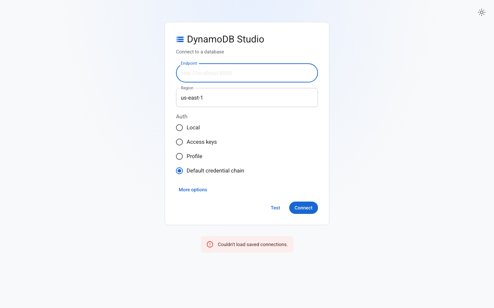
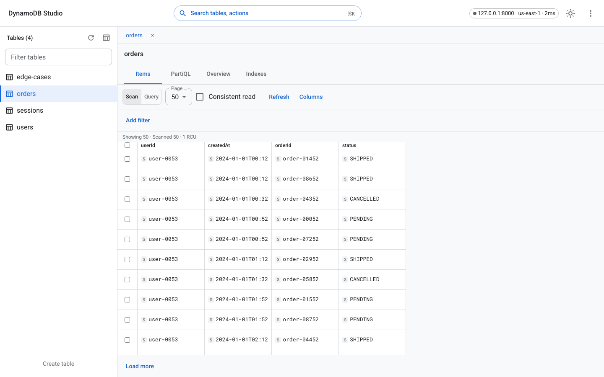
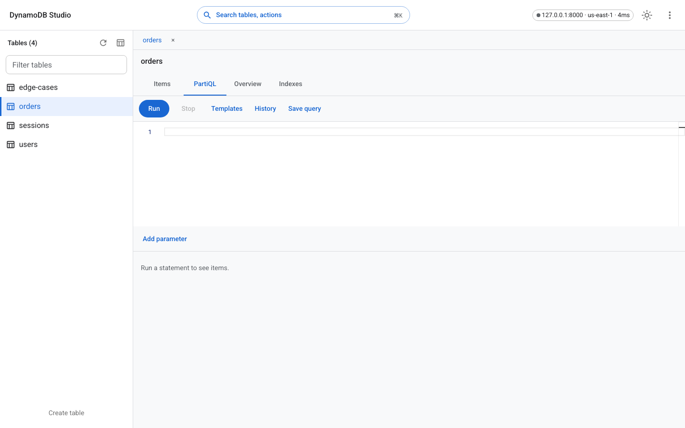

# DynamoDB Studio

A calm, minimal client for DynamoDB. Paste an endpoint, click **Connect**, and browse tables, edit items, run PartiQL, and move data in and out.







## Quick start

You need Node.js 22 or newer and Docker. `.nvmrc` pins 22, which is the supported major. A newer major still starts. The server logs `Node.js 22 is the supported major. This process is <version>.` and keeps running. Engines stay `>=22`.

This repository has no git remote. There is no clone URL here because none was verified. Start in a checkout of this source.

The steps below expect host ports 8000, 5173, and 8080 to be free. If one is taken, use the port section. Do not stop a container or process you did not start.

1. Start DynamoDB Local in the background so the next commands can run in this terminal:

```bash
docker run -d --rm --name dynamodb-local -p 8000:8000 amazon/dynamodb-local
```

`docker-compose.yml` is the same image with `-sharedDb -inMemory`. `pnpm dev:db` runs `docker compose up -d dynamodb-local` and also publishes host port 8000. A different compose project name does not free that port.

2. Install, seed the sample tables, and start the app:

```bash
pnpm install
pnpm seed
pnpm dev
```

`pnpm seed` writes to `DYNAMO_ENDPOINT`, which defaults to `http://127.0.0.1:8000`.

3. Open [http://127.0.0.1:5173](http://127.0.0.1:5173).
4. Paste `http://localhost:8000` into **Endpoint**. Choose **Local** (a fresh screen starts on **Default credential chain**) and click **Connect**.
5. The sidebar lists `edge-cases`, `orders`, `sessions`, and `users`. Open **orders**. Items shows `userId`, `createdAt`, `orderId`, and `status`.

### When a port is taken

`docker run -p 8000:8000` fails with `Bind for 0.0.0.0:8000 failed: port is already allocated` when something is already listening. Leave it running and publish a free host port:

```bash
docker run -d --rm --name dynamodb-local-alt -p 127.0.0.1:8001:8000 amazon/dynamodb-local
DYNAMO_ENDPOINT=http://127.0.0.1:8001 pnpm seed
```

Connect to `http://localhost:8001`.

`pnpm dev` serves the UI on port 5173 and the API on port 8080. If 8080 is taken, the API logs `listen EADDRINUSE: address already in use 127.0.0.1:8080` and waits for a file change. Vite may print `Port 5173 is in use, trying another one...` and still proxy `/api` to 8080. That page is not this checkout. Stop the `pnpm dev` you just started, then bind both sides to free ports. `WEB_PORT` keeps Vite on that port. `API_PROXY` is the API it forwards `/api` to. `ALLOWED_ORIGINS` has to include the UI origin. The built-in list is only ports 5173 and 8080:

```bash
PORT=8081 \
WEB_PORT=5174 \
API_PROXY=http://127.0.0.1:8081 \
ALLOWED_ORIGINS=http://127.0.0.1:5174,http://localhost:5174 \
pnpm dev
```

Open the `WEB_PORT` you chose. For the command above that is [http://127.0.0.1:5174](http://127.0.0.1:5174).

## Features

- Connect to DynamoDB Local, a custom endpoint, or AWS (access key, profile, or the default credential chain).
- Search tables, inspect keys, indexes, and TTL, and create a table with a guided form.
- Scan and query a virtualized grid, then open an item and copy it as JSON.
- Edit JSON with live validation, save, and undo.
- Run PartiQL with syntax highlighting, history, and saved queries.
- Import JSON, NDJSON, or CSV after a preview. Export JSON, NDJSON, or CSV.
- Light and dark themes, a command palette, and keyboard shortcuts (`?` opens the list).

## Security

Credentials stay on the server after connect. The browser keeps an httpOnly session cookie and sends `x-ds-csrf` on writes. A foreign `Host` or `Origin` is rejected. Read-only mode is enforced on the server. Destructive actions ask for confirmation, and a production-tagged connection asks you to type the name.

The API binds to loopback unless you set `HOST`. A non-loopback bind logs a warning. `ALLOWED_ORIGINS` is a comma-separated list of extra browser origins when you put the app behind a reverse proxy.

Details and the dependency-audit exception are in [docs/SECURITY.md](docs/SECURITY.md).

## Install from a tarball or image

Build a local tarball (the root package stays private; this does not publish):

```bash
pnpm build
pnpm exec tsx scripts/pack-cli.ts
npm install -g ./dist-pack/dynamo-studio.tgz
dynamo-studio --port 8080 --host 127.0.0.1
```

`dynamo-studio` accepts `--port`, `--host`, `--home`, and `--open`. If the port is in use, the message names that port and suggests `--port`.

The container image is non-root, listens on 8080, and checks `/api/v1/health`. See [docker-compose.example.yml](docker-compose.example.yml). Do not publish that example while something else is already bound to host port 8080.

## FAQ

**The connect card says it could not reach my endpoint.** The message includes the URL you typed. For DynamoDB Local, check that the container from the quick start is still running and that the endpoint is the host port you published, usually `http://localhost:8000`.

**Can I avoid writing data?** Turn on **Read-only** before you connect. The server rejects writes for that session.

**Where are saved connections?** In the home directory under `.dynamo-studio`, or in the directory you pass with `--home` / `DYNAMO_STUDIO_HOME`. Secrets are not stored in the browser.

**Does an edit detect every concurrent change?** The save checks the item you loaded, then writes with attribute equality when the item is small enough. An attribute added by someone else between the read and the write is not detected. The guide explains that limit.

## Contributing

See [docs/CONTRIBUTING.md](docs/CONTRIBUTING.md), [docs/USER-GUIDE.md](docs/USER-GUIDE.md), and [docs/ARCHITECTURE.md](docs/ARCHITECTURE.md). License: MIT.
